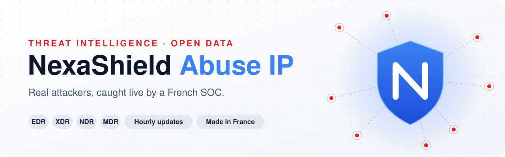
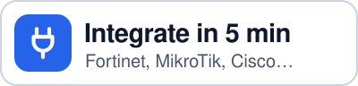
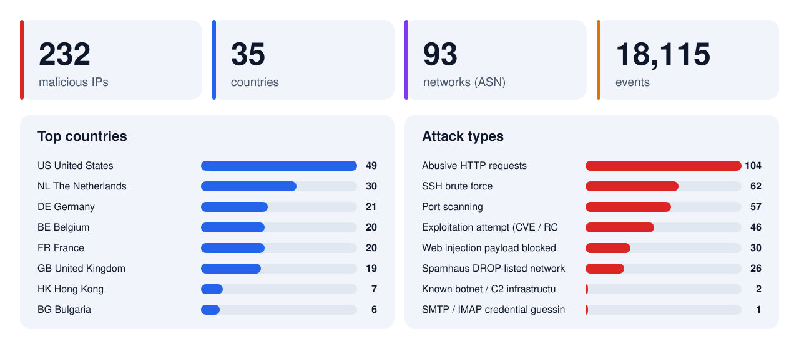

<picture>
  <source width="100%" srcset="assets/banner-dark.svg" media="(prefers-color-scheme: dark)">
  <source width="100%" srcset="assets/banner-light.svg" media="(prefers-color-scheme: light), (prefers-color-scheme: no-preference)">
  
</picture>

<h1 align="center">NexaShield Abuse IP</h1>

<p align="center"><b>We built it to protect our infrastructure.<br>We share it for free to protect yours.</b></p>

<p align="center">Every address on this list really attacked a server we protect.<br>Our SOC detected it, proved it and reported it to its network owner. Block it before it hits you.</p>

<p align="center">
  [<a href="docs/INTEGRATION.md">Integration guide</a>]
  [<a href="lists/plain/all.txt">Raw list</a>]
  [<a href="analysis/latest.md">AI analysis (FR)</a>]
  [<a href="https://bastivan.com">Bastivan Consulting</a>]
  [<a href="README.md">Français</a>]
</p>

<p align="center">
  
  
  
  <a href="https://github.com/bastivanconsulting/Nexashield-Abuse-IP/actions/workflows/ci.yml"></a>
  <a href="https://github.com/bastivanconsulting/Nexashield-Abuse-IP/stargazers"></a>
  
  <a href="https://creativecommons.org/licenses/by/4.0/"></a>
  
</p>

<p align="center">
  <a href="https://raw.githubusercontent.com/bastivanconsulting/Nexashield-Abuse-IP/main/lists/plain/all.txt"><picture>
    <source width="32%" srcset="assets/btn-download-en-dark.svg" media="(prefers-color-scheme: dark)">
    
  </picture></a>
  <a href="docs/INTEGRATION.md"><picture>
    <source width="32%" srcset="assets/btn-plug-en-dark.svg" media="(prefers-color-scheme: dark)">
    
  </picture></a>
  <a href="mailto:contact@bastivan.com?subject=NexaShield"><picture>
    <source width="32%" srcset="assets/btn-shield-en-dark.svg" media="(prefers-color-scheme: dark)">
    
  </picture></a>
</p>

<picture>
  <source width="100%" srcset="assets/stats-en-dark.svg" media="(prefers-color-scheme: dark)">
  
</picture>

> [!TIP]
> **One URL for all your firewalls**, refreshed automatically:
> `https://raw.githubusercontent.com/bastivanconsulting/Nexashield-Abuse-IP/main/lists/plain/all.txt`

## 💡 Why we publish it

NexaShield protects **our own infrastructure** first. Every hour it sees bots guessing passwords, probing for known vulnerabilities or slipping malicious code into web forms. The same addresses hit you too, often without anyone noticing.

Keeping that knowledge to ourselves made no sense. So we publish it: **free, no sign-up, no API key**. One command is enough for your firewall to block what our SOC has already seen and proven.

And the more networks shut the door on these addresses, the less they pay off for the people running them. **Every block counts.**

## ✨ Why this list is different

- [x] **Seen attacks, not rumours**: every IP really hit infrastructure monitored by NexaShield. No copied feeds.
- [x] **Evidence thresholds** per attack type; known false positives removed (CDNs, search engines, research scanners, spoofable UDP).
- [x] **Reported at the source**: the network's official abuse contact receives redacted evidence before publication.
- [x] **Hands-off updates**: the SOC checks every hour and publishes as soon as a new attack is confirmed.
- [x] **Ready to use**: Fortinet, MikroTik, Cisco, pfSense, OPNsense, Windows, Linux… and Wazuh, CrowdSec, Suricata, OpenCTI, MISP, Splunk, Kubernetes.
- [x] **Built for analysis**: country → network (ASN) → IP, with a readable page and a JSON record for every address.
- [x] **Zero customer data**: no hostnames, no targets, no raw logs.

## 📊 Your own dashboard, on your machine

The Linux installer opens a **local dashboard** at `http://127.0.0.1:8787`: see live what NexaShield blocks **on this machine**.

- 🛡️ **Protection status**: list freshness, active engine, protected since.
- 📈 **Blocked attempts**: total, today, per day and hour by hour.
- 🌍 **Map of attackers stopped on your machine**, with country, network and attack type.
- 🔎 **Lookup**: is an IP listed, and has it already tried to reach you?

Nothing leaves your machine: counters come from your own firewall, the page only listens locally (remote access via `ssh -L 8787:127.0.0.1:8787 your-server`), and the web server runs with no privileges at all.

## 🚀 30-second install, automatic updates

The installers block **inbound and outbound** traffic, then **update themselves every hour**. Local allowlist, safeguard against truncated downloads, one-command uninstall.

<details open>
<summary> <b>Linux</b> (nftables or ipset + iptables, systemd timer or cron)</summary>

```bash
curl -fsSLO https://raw.githubusercontent.com/bastivanconsulting/Nexashield-Abuse-IP/main/tools/linux/install.sh
less install.sh          # always read a script before running it
sudo bash install.sh
```
Dashboard: `http://127.0.0.1:8787` · status: `sudo nexashield-blocklist status` · allowlist: `/etc/nexashield/allowlist.txt` · uninstall: `sudo bash install.sh --uninstall`
</details>

<details>
<summary> <b>Windows</b> (Windows Defender Firewall, scheduled task)</summary>

**Administrator** PowerShell:
```powershell
$u = "https://raw.githubusercontent.com/bastivanconsulting/Nexashield-Abuse-IP/main/tools/windows"
iwr -UseBasicParsing "$u/Install-NexaShield.ps1" -OutFile Install-NexaShield.ps1
iwr -UseBasicParsing "$u/Update-NexaShieldBlocklist.ps1" -OutFile Update-NexaShieldBlocklist.ps1
powershell -NoProfile -ExecutionPolicy Bypass -File .\Install-NexaShield.ps1
```
Allowlist: `C:\ProgramData\NexaShield\allowlist.txt` · uninstall: `.\Install-NexaShield.ps1 -Uninstall`
</details>

<details>
<summary> <b>MikroTik RouterOS v7</b> (scheduler, raw table)</summary>

```
/tool fetch url="https://raw.githubusercontent.com/bastivanconsulting/Nexashield-Abuse-IP/main/tools/mikrotik/install.rsc" dst-path=nexashield-install.rsc
/import file-name=nexashield-install.rsc
```
</details>

<details>
<summary> <b>Fortinet FortiGate</b> (Threat Feed, refreshed by the firewall)</summary>

```
config system external-resource
    edit "NexaShield-Abuse-IP"
        set type address
        set resource "https://raw.githubusercontent.com/bastivanconsulting/Nexashield-Abuse-IP/main/lists/plain/all.txt"
        set refresh-rate 60
    next
end
```
</details>

Cisco, pfSense, OPNsense, nftables, UFW, nginx: **[full guide (FR) →](docs/INTEGRATION.md)**

---

## 📊 Threat landscape

<table>
<tr>
<td valign="top" width="50%">

#### 🌍 Top countries

| Country | IPs |
|---|---:|
| 🇺🇸 [United States](countries/US_United-States/) | 49 |
| 🇳🇱 [The Netherlands](countries/NL_The-Netherlands/) | 31 |
| 🇩🇪 [Germany](countries/DE_Germany/) | 21 |
| 🇧🇪 [Belgium](countries/BE_Belgium/) | 20 |
| 🇫🇷 [France](countries/FR_France/) | 20 |
| 🇬🇧 [United Kingdom](countries/GB_United-Kingdom/) | 19 |
| 🇭🇰 [Hong Kong](countries/HK_Hong-Kong/) | 8 |
| 🇧🇬 [Bulgaria](countries/BG_Bulgaria/) | 6 |
| 🇰🇷 [South Korea](countries/KR_South-Korea/) | 6 |
| 🇨🇳 [China](countries/CN_China/) | 5 |
| 🇦🇺 [Australia](countries/AU_Australia/) | 4 |
| 🇵🇰 [Pakistan](countries/PK_Pakistan/) | 4 |
| 🇸🇬 [Singapore](countries/SG_Singapore/) | 4 |
| 🇨🇦 [Canada](countries/CA_Canada/) | 3 |
| 🇫🇮 [Finland](countries/FI_Finland/) | 3 |

➡️ [All countries](countries/)

</td>
<td valign="top" width="50%">

#### 🎯 Attack types

| Type | IPs |
|---|---:|
| Abusive HTTP requests | 105 |
| SSH brute force | 62 |
| Port scanning | 57 |
| Exploitation attempt (CVE / RCE / injection) | 47 |
| Web injection payload blocked by WAF | 30 |
| Spamhaus DROP-listed network | 26 |
| Known botnet / C2 infrastructure | 2 |
| SMTP / IMAP credential guessing | 1 |
| UDP exploit signature | 1 |

</td>
</tr>
</table>

#### 🏢 Top networks (ASN)

| ASN | Owner | Countries (IPs) | Total IPs |
|---|---|---|---:|
| **AS14061** | DigitalOcean, LLC | [🇺🇸 20](countries/US_United-States/AS14061_DigitalOcean-LLC/) [🇩🇪 7](countries/DE_Germany/AS14061_DigitalOcean-LLC/) [🇳🇱 7](countries/NL_The-Netherlands/AS14061_DigitalOcean-LLC/) [🇬🇧 5](countries/GB_United-Kingdom/AS14061_DigitalOcean-LLC/) [🇦🇺 4](countries/AU_Australia/AS14061_DigitalOcean-LLC/) [🇸🇬 4](countries/SG_Singapore/AS14061_DigitalOcean-LLC/) [🇨🇦 2](countries/CA_Canada/AS14061_DigitalOcean-LLC/) | 49 |
| **AS396982** | Google LLC | [🇧🇪 17](countries/BE_Belgium/AS396982_Google-LLC/) [🇩🇪 2](countries/DE_Germany/AS396982_Google-LLC/) [🇮🇳 2](countries/IN_India/AS396982_Google-LLC/) [🇯🇵 2](countries/JP_Japan/AS396982_Google-LLC/) [🇨🇦 1](countries/CA_Canada/AS396982_Google-LLC/) [🇰🇷 1](countries/KR_South-Korea/AS396982_Google-LLC/) [🇳🇱 1](countries/NL_The-Netherlands/AS396982_Google-LLC/) [🇺🇸 1](countries/US_United-States/AS396982_Google-LLC/) | 27 |
| **AS198364** | BANATSYNC SRL | [🇫🇷 16](countries/FR_France/AS198364_BANATSYNC-SRL/) [🇳🇱 5](countries/NL_The-Netherlands/AS198364_BANATSYNC-SRL/) | 21 |
| **AS14618** | Amazon.com, Inc. | [🇺🇸 11](countries/US_United-States/AS14618_Amazon-com-Inc/) | 11 |
| **AS197170** | TechTies Inc. | [🇳🇱 9](countries/NL_The-Netherlands/AS197170_TechTies-Inc/) [🇩🇪 2](countries/DE_Germany/AS197170_TechTies-Inc/) | 11 |
| **AS202306** | HOSTGLOBAL.PLUS LTD | [🇬🇧 9](countries/GB_United-Kingdom/AS202306_HOSTGLOBAL-PLUS-LTD/) | 9 |
| **AS16509** | Amazon.com, Inc. | [🇺🇸 6](countries/US_United-States/AS16509_Amazon-com-Inc/) [🇮🇪 1](countries/IE_Ireland/AS16509_Amazon-com-Inc/) [🇸🇪 1](countries/SE_Sweden/AS16509_Amazon-com-Inc/) | 8 |
| **AS8075** | Microsoft Corporation | [🇦🇪 2](countries/AE_United-Arab-Emirates/AS8075_Microsoft-Corporation/) [🇳🇱 2](countries/NL_The-Netherlands/AS8075_Microsoft-Corporation/) [🇮🇪 1](countries/IE_Ireland/AS8075_Microsoft-Corporation/) [🇮🇱 1](countries/IL_Israel/AS8075_Microsoft-Corporation/) [🇺🇸 1](countries/US_United-States/AS8075_Microsoft-Corporation/) | 7 |
| **AS132203** | Shenzhen Tencent Computer Systems Company Limited | [🇭🇰 3](countries/HK_Hong-Kong/AS132203_Shenzhen-Tencent-Computer-Systems-Company-Limite/) [🇩🇪 1](countries/DE_Germany/AS132203_Shenzhen-Tencent-Computer-Systems-Company-Limite/) [🇰🇷 1](countries/KR_South-Korea/AS132203_Shenzhen-Tencent-Computer-Systems-Company-Limite/) [🇹🇭 1](countries/TH_Thailand/AS132203_Shenzhen-Tencent-Computer-Systems-Company-Limite/) [🇺🇸 1](countries/US_United-States/AS132203_Shenzhen-Tencent-Computer-Systems-Company-Limite/) | 7 |
| **AS12876** | Scaleway SAS | [🇵🇱 2](countries/PL_Poland/AS12876_Scaleway-SAS/) [🇫🇷 1](countries/FR_France/AS12876_Scaleway-SAS/) [🇮🇹 1](countries/IT_Italy/AS12876_Scaleway-SAS/) [🇳🇱 1](countries/NL_The-Netherlands/AS12876_Scaleway-SAS/) | 5 |

---

## 🔧 Works with your devices

| Device | File / method |
|---|---|
|  **Fortinet FortiGate** | Threat Feed (External Connector) → [`lists/plain/all.txt`](lists/plain/all.txt) |
|  **MikroTik RouterOS** | installer [`tools/mikrotik/install.rsc`](tools/mikrotik/install.rsc) · list [`lists/mikrotik.rsc`](lists/mikrotik.rsc) |
|  **Cisco ASA / IOS / FTD** | [`lists/cisco-asa.txt`](lists/cisco-asa.txt) · [`lists/cisco-ios.txt`](lists/cisco-ios.txt) · FMC Security Intelligence feed |
|  **pfSense** (and pfBlockerNG) | *URL Table (IPs)* alias → [`lists/plain/all.txt`](lists/plain/all.txt) |
|  **OPNsense** | *URL Table (IPs)* alias → [`lists/plain/all.txt`](lists/plain/all.txt) |
|  **Windows** | installer [`tools/windows/Install-NexaShield.ps1`](tools/windows/Install-NexaShield.ps1) (scheduled task) |
|  **Linux** | installer [`tools/linux/install.sh`](tools/linux/install.sh) (nftables / ipset) · UFW → [`lists/plain/all.txt`](lists/plain/all.txt) |
|  **nginx** | [`lists/nginx-deny.conf`](lists/nginx-deny.conf) |
|  **Others** (Palo Alto EDL, Stormshield, Sophos, Check Point…) | any URL-based address list → [`lists/plain/all.txt`](lists/plain/all.txt) |

For SIEM or analysis: [`lists/abuse-ip.csv`](lists/abuse-ip.csv) · [`lists/abuse-ip.json`](lists/abuse-ip.json) (country, ASN, attack types, dates).

---

## 🧩 Plugs into your software

| SIEM & detection | Threat intelligence | Web & containers |
|---|---|---|
| **Wazuh** (CDB list) · [`wazuh-cdb.txt`](lists/wazuh-cdb.txt) | **OpenCTI** · **MISP** · **Sentinel** · [`stix2-bundle.json`](lists/stix2-bundle.json) | **Apache** · [`apache-deny.conf`](lists/apache-deny.conf) |
| **CrowdSec** · [`crowdsec-decisions.json`](lists/crowdsec-decisions.json) | Stable STIX 2.1 IDs: no duplicates | **HAProxy** · **Cloudflare** · **Proxmox VE** |
| **Suricata / Snort 3** · [`suricata.rules`](lists/suricata.rules) | | **Kubernetes / Cilium** · [`cilium-clusterwide-deny.yaml`](lists/kubernetes/cilium-clusterwide-deny.yaml) |
| **Splunk** · **Elastic** · **Graylog** · [`abuse-ip.csv`](lists/abuse-ip.csv) | | **Docker** (via the Linux installer) |

Step-by-step for each tool (FR): **[docs/SOFTWARE.md](docs/SOFTWARE.md)**

---

## 🧠 Behind this list: NexaShield

This list is a by-product. **NexaShield** is the detection and response platform of [Bastivan Consulting](https://bastivan.com), four layers working together:

| | Layer | What it does for you |
|:-:|---|---|
| 🖥️ | **EDR** · *Endpoint Detection & Response* | Watches every workstation and server (Linux, Windows, macOS, Kubernetes containers): processes, file integrity, persistence, privilege escalation, automatic malware quarantine. |
| 🌐 | **NDR** · *Network Detection & Response* | Continuous traffic analysis: exploit signatures, scans, suspicious DNS, *beaconing*, connections to known malicious infrastructure. |
| 🔗 | **XDR** · *Extended Detection & Response* | Correlates EDR, NDR, web, authentication and mail signals in real time to rebuild **the full attack timeline**, not just an isolated alert. |
| 👁️ | **MDR** · *Managed Detection & Response* | Our SOC (case management, threat intelligence, automatic IOC enrichment) watches, triages and responds for you. |

### 🆚 The free list… or NexaShield on your infrastructure

| | This list | NexaShield |
|---|:-:|:-:|
| Block IPs already seen by our SOC | ✅ | ✅ |
| Detect attacks targeting **your** endpoints, servers and containers | ❌ | ✅ |
| Analyse **your** network traffic (exploits, DNS, *beaconing*) | ❌ | ✅ |
| Rebuild the full attack timeline | ❌ | ✅ |
| Automatic ban, session kill, container isolation, quarantine | ❌ | ✅ |
| A SOC that triages your alerts and supports you | ❌ | ✅ |
| Audit-ready **NIS2 / DORA** reports | ❌ | ✅ |

<p align="center">
  <a href="mailto:contact@bastivan.com?subject=NexaShield"></a>
  <a href="https://bastivan.com"></a>
</p>

---

## ✅ How an IP gets here

<details>
<summary>Six evidence gates</summary>

1. **Real inbound attack** observed by NexaShield (never reputation alone).
2. **Evidence threshold** per type: 1 C2 contact, 2 exploits, 5 malicious web requests, 10 SSH failures.
3. **At least one application-level event**: a port scan alone is not enough.
4. **False positives removed**: CDNs, search engines, known scanning companies, UDP (spoofable), legitimate clients that logged in successfully.
5. **Abuse report** sent to the network's official contact (RIPEstat).
6. **Published** here, sorted by country, network and address.
</details>

## ⚠️ Disclaimer

- A listed IP is often a **compromised machine** or a short-lived rented server: its owner is not necessarily the attacker.
- Addresses change hands: use this data with a **limited lifetime** and at your own risk. Start in log-only mode.
- **Removal / dispute**: [removal request](https://github.com/bastivanconsulting/Nexashield-Abuse-IP/issues/new?template=removal-request.yml) or [contact@bastivan.com](mailto:contact@bastivan.com).

## 🤝 Community

[Contributing](CONTRIBUTING.md) · [Security policy](SECURITY.md) · [Code of conduct](CODE_OF_CONDUCT.md)

## ⭐ Support the project

If this list protects your network, **a star** helps other admins find it.

<a href="https://star-history.com/#bastivanconsulting/Nexashield-Abuse-IP&Date">
  <picture>
    <source media="(prefers-color-scheme: dark)" srcset="https://api.star-history.com/svg?repos=bastivanconsulting/Nexashield-Abuse-IP&type=Date&theme=dark">
    
  </picture>
</a>

## 📜 License and attribution

- Data and scripts under **[CC BY 4.0](https://creativecommons.org/licenses/by/4.0/)**: credit "NexaShield Abuse IP · Bastivan Consulting".
- IP geolocation by **[DB-IP](https://db-ip.com)** (CC BY 4.0). Network owners and abuse contacts: **[RIPEstat](https://stat.ripe.net)**.
- Device logos: [Simple Icons](https://simpleicons.org) (CC0). Trademarks belong to their owners and only indicate compatibility.

---

<div align="center">

**🛡️ NexaShield** · *Detect. Correlate. Respond.*

© 2026 [Bastivan Consulting SAS](https://bastivan.com) · Consulting, managed services, cloud and cybersecurity · Beauvais, France

</div>
