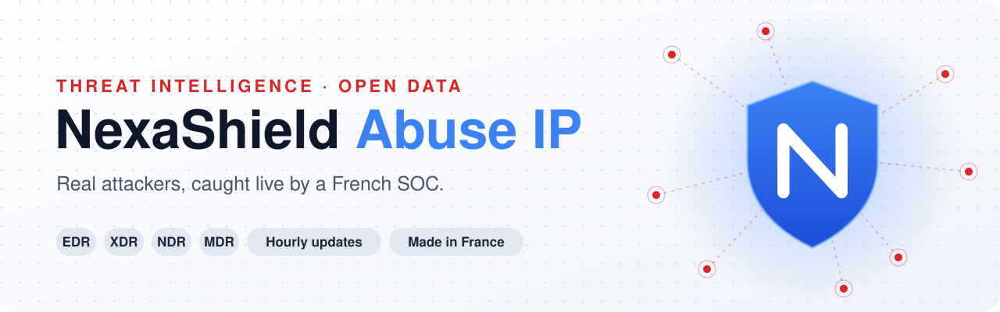
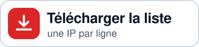
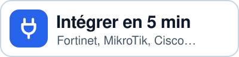
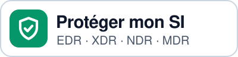
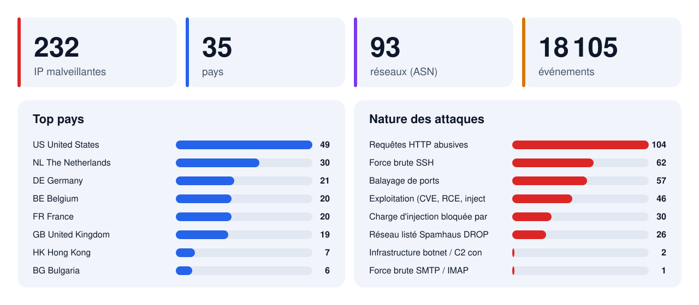

<picture>
  <source width="100%" srcset="assets/banner-dark.svg" media="(prefers-color-scheme: dark)">
  <source width="100%" srcset="assets/banner-light.svg" media="(prefers-color-scheme: light), (prefers-color-scheme: no-preference)">
  
</picture>

<h1 align="center">NexaShield Abuse IP</h1>

<p align="center"><b>Nous l'avons construit pour protéger notre infrastructure.<br>Nous le partageons gratuitement pour protéger la vôtre.</b></p>

<p align="center">Chaque adresse de cette liste a réellement attaqué un serveur que nous protégeons.<br>Notre SOC l'a détectée, prouvée et signalée à son hébergeur. À vous de la bloquer avant qu'elle ne frappe chez vous.</p>

<p align="center">
  [<a href="docs/INTEGRATION.md">Guide d'intégration</a>]
  [<a href="lists/plain/all.txt">Liste brute</a>]
  [<a href="analysis/latest.md">Analyse IA</a>]
  [<a href="https://bastivan.com">Bastivan Consulting</a>]
  [<a href="README.en.md">English</a>]
</p>

<p align="center">
  
  
  
  <a href="https://github.com/bastivanconsulting/Nexashield-Abuse-IP/stargazers"></a>
  
  <a href="https://creativecommons.org/licenses/by/4.0/"></a>
  
</p>

<p align="center">
  <a href="https://raw.githubusercontent.com/bastivanconsulting/Nexashield-Abuse-IP/main/lists/plain/all.txt"><picture>
    <source width="32%" srcset="assets/btn-download-fr-dark.svg" media="(prefers-color-scheme: dark)">
    
  </picture></a>
  <a href="docs/INTEGRATION.md"><picture>
    <source width="32%" srcset="assets/btn-plug-fr-dark.svg" media="(prefers-color-scheme: dark)">
    
  </picture></a>
  <a href="mailto:contact@bastivan.com?subject=NexaShield"><picture>
    <source width="32%" srcset="assets/btn-shield-fr-dark.svg" media="(prefers-color-scheme: dark)">
    
  </picture></a>
</p>

<picture>
  <source width="100%" srcset="assets/stats-fr-dark.svg" media="(prefers-color-scheme: dark)">
  
</picture>

> [!TIP]
> **Une seule URL pour tous vos pare-feu**, rafraîchie automatiquement :
> `https://raw.githubusercontent.com/bastivanconsulting/Nexashield-Abuse-IP/main/lists/plain/all.txt`

## 💡 Pourquoi nous la publions

NexaShield protège d'abord **notre propre infrastructure**. Chaque heure, il voit passer des robots qui devinent des mots de passe, cherchent des failles connues ou glissent du code malveillant dans des formulaires. Ces mêmes adresses frappent aussi chez vous, souvent sans que personne ne s'en aperçoive.

Garder cette connaissance pour nous n'aurait aucun sens. Alors nous la publions : **gratuitement, sans inscription, sans clé d'API**. Une commande suffit pour que votre pare-feu bloque ce que notre SOC a déjà vu et prouvé.

Et plus il y a de réseaux qui ferment la porte à ces adresses, moins elles rapportent à ceux qui les exploitent. **Chaque blocage compte.**

## ✨ Pourquoi cette liste est différente

- [x] **Des attaques vues, pas des rumeurs** : chaque IP a réellement frappé une infrastructure surveillée par NexaShield. Aucune liste recopiée.
- [x] **Des seuils de preuve** par nature d'attaque, et les faux positifs connus écartés (CDN, moteurs de recherche, scanners de recherche, UDP falsifiable).
- [x] **Signalée à la source** : le contact abuse officiel du réseau reçoit les preuves expurgées avant toute publication.
- [x] **À jour sans intervention** : le SOC vérifie toutes les heures et publie dès qu'une nouvelle attaque est confirmée.
- [x] **Prête à l'emploi** : Fortinet, MikroTik, Cisco, pfSense, OPNsense, Windows, Linux… et Wazuh, CrowdSec, Suricata, OpenCTI, MISP, Splunk, Kubernetes.
- [x] **Rangée pour l'analyse** : pays → réseau (ASN) → IP, avec une fiche lisible et une fiche JSON pour chaque adresse.
- [x] **Zéro donnée client** : ni nom d'hôte, ni adresse cible, ni journal brut.
- [x] **Synthèse rédigée par l'IA**, avec contrôle automatique des chiffres.

## 📊 Votre tableau de bord, chez vous

L'installateur Linux ouvre un **tableau de bord local** sur `http://127.0.0.1:8787` : voyez en direct ce que NexaShield bloque **sur votre machine**.

- 🛡️ **État de la protection** : liste à jour, moteur actif, protégé depuis quand.
- 📈 **Tentatives bloquées** : total, aujourd'hui, par jour et heure par heure.
- 🌍 **Carte des attaquants stoppés chez vous**, avec leur pays, leur réseau et la nature de leurs attaques.
- 🔎 **Recherche** : une IP est-elle listée, et a-t-elle déjà tenté de vous joindre ?

Rien ne sort de votre machine : les compteurs viennent de votre pare-feu, la page n'écoute qu'en local (accès distant par `ssh -L 8787:127.0.0.1:8787 votre-serveur`), et le serveur web tourne sans aucun droit.

## 🚀 Installation en 30 secondes, mise à jour automatique

Les installateurs appliquent le blocage **en entrée et en sortie**, puis **se mettent à jour tout seuls toutes les heures**. Liste d'exceptions locale, garde-fou contre une liste tronquée, désinstallation en une commande.

<details open>
<summary> <b>Linux</b> (nftables ou ipset + iptables, timer systemd ou cron)</summary>

```bash
curl -fsSLO https://raw.githubusercontent.com/bastivanconsulting/Nexashield-Abuse-IP/main/tools/linux/install.sh
less install.sh          # lisez toujours un script avant de l'exécuter
sudo bash install.sh
```
Tableau de bord : `http://127.0.0.1:8787` · état : `sudo nexashield-blocklist status` · exceptions : `/etc/nexashield/allowlist.txt` · désinstaller : `sudo bash install.sh --uninstall`
</details>

<details>
<summary> <b>Windows</b> (pare-feu Windows Defender, tâche planifiée)</summary>

PowerShell **administrateur** :
```powershell
$u = "https://raw.githubusercontent.com/bastivanconsulting/Nexashield-Abuse-IP/main/tools/windows"
iwr -UseBasicParsing "$u/Install-NexaShield.ps1" -OutFile Install-NexaShield.ps1
iwr -UseBasicParsing "$u/Update-NexaShieldBlocklist.ps1" -OutFile Update-NexaShieldBlocklist.ps1
powershell -NoProfile -ExecutionPolicy Bypass -File .\Install-NexaShield.ps1
```
Exceptions : `C:\ProgramData\NexaShield\allowlist.txt` · désinstaller : `.\Install-NexaShield.ps1 -Uninstall`
</details>

<details>
<summary> <b>MikroTik RouterOS v7</b> (planificateur, table raw)</summary>

```
/tool fetch url="https://raw.githubusercontent.com/bastivanconsulting/Nexashield-Abuse-IP/main/tools/mikrotik/install.rsc" dst-path=nexashield-install.rsc
/import file-name=nexashield-install.rsc
```
</details>

<details>
<summary> <b>Fortinet FortiGate</b> (Threat Feed, rafraîchi par le pare-feu)</summary>

```
config system external-resource
    edit "NexaShield-Abuse-IP"
        set type address
        set resource "https://raw.githubusercontent.com/bastivanconsulting/Nexashield-Abuse-IP/main/lists/plain/all.txt"
        set refresh-rate 60
    next
end
```
</details>

Cisco, pfSense, OPNsense, nftables, UFW, nginx, mise à jour planifiée : **[guide complet →](docs/INTEGRATION.md)**

---

## 🤖 Analyse de la menace par l'IA NexaShield

Sur la période observée, le dépôt recense 18089 événements répartis sur 231 adresses IP issues de 35 pays et 93 réseaux ASN, avec une dernière activité enregistrée le 2026-11-13. Les principales origines géographiques incluent les États-Unis avec 48 adresses, les Pays-Bas avec 30, l'Allemagne avec 21, la Belgique et la France avec 20 chacune. Les réseaux les plus représentés sont AS14061 (DigitalOcean, LLC) avec 49 adresses, AS396982 (Google LLC) avec 27 et AS198364 (BANATSYNC SRL) avec 21.

- Les natures d'événements observées comprennent 104 requêtes HTTP abusives, 62 tentatives de force brute SSH et 56 balayages de ports.
- On relève également 46 cas d'exploitation (CVE, RCE, injection), 30 charges d'injection bloquées par le WAF et 26 réseaux listés Spamhaus DROP.
- Parmi les autres signaux figurent 2 infrastructures botnet / C2 connues, 1 force brute SMTP / IMAP et 1 signature d'exploit UDP.

<sub>Synthèse générée automatiquement le 2026-11-13 par l'IA NexaShield (Mistral AI, modèle européen) à partir des seules statistiques de ce dépôt ; relue par aucun humain avant publication, à titre indicatif.</sub>

---

## 📊 Le paysage de la menace

<table>
<tr>
<td valign="top" width="50%">

#### 🌍 Top pays

| Pays | IP |
|---|---:|
| 🇺🇸 [United States](countries/US_United-States/) | 49 |
| 🇳🇱 [The Netherlands](countries/NL_The-Netherlands/) | 30 |
| 🇩🇪 [Germany](countries/DE_Germany/) | 21 |
| 🇧🇪 [Belgium](countries/BE_Belgium/) | 20 |
| 🇫🇷 [France](countries/FR_France/) | 20 |
| 🇬🇧 [United Kingdom](countries/GB_United-Kingdom/) | 19 |
| 🇭🇰 [Hong Kong](countries/HK_Hong-Kong/) | 7 |
| 🇧🇬 [Bulgaria](countries/BG_Bulgaria/) | 6 |
| 🇰🇷 [South Korea](countries/KR_South-Korea/) | 6 |
| 🇨🇳 [China](countries/CN_China/) | 5 |
| 🇦🇺 [Australia](countries/AU_Australia/) | 4 |
| 🇵🇰 [Pakistan](countries/PK_Pakistan/) | 4 |
| 🇸🇬 [Singapore](countries/SG_Singapore/) | 4 |
| 🇨🇦 [Canada](countries/CA_Canada/) | 3 |
| 🇫🇮 [Finland](countries/FI_Finland/) | 3 |

➡️ [Tous les pays](countries/)

</td>
<td valign="top" width="50%">

#### 🎯 Nature des attaques

| Nature | IP |
|---|---:|
| Requêtes HTTP abusives | 104 |
| Force brute SSH | 62 |
| Balayage de ports | 57 |
| Exploitation (CVE, RCE, injection) | 46 |
| Charge d'injection bloquée par le WAF | 30 |
| Réseau listé Spamhaus DROP | 26 |
| Infrastructure botnet / C2 connue | 2 |
| Force brute SMTP / IMAP | 1 |
| Signature d'exploit UDP | 1 |

</td>
</tr>
</table>

#### 🏢 Top réseaux (ASN)

| ASN | Opérateur | Pays (IP) | Total IP |
|---|---|---|---:|
| **AS14061** | DigitalOcean, LLC | [🇺🇸 20](countries/US_United-States/AS14061_DigitalOcean-LLC/) [🇩🇪 7](countries/DE_Germany/AS14061_DigitalOcean-LLC/) [🇳🇱 7](countries/NL_The-Netherlands/AS14061_DigitalOcean-LLC/) [🇬🇧 5](countries/GB_United-Kingdom/AS14061_DigitalOcean-LLC/) [🇦🇺 4](countries/AU_Australia/AS14061_DigitalOcean-LLC/) [🇸🇬 4](countries/SG_Singapore/AS14061_DigitalOcean-LLC/) [🇨🇦 2](countries/CA_Canada/AS14061_DigitalOcean-LLC/) | 49 |
| **AS396982** | Google LLC | [🇧🇪 17](countries/BE_Belgium/AS396982_Google-LLC/) [🇩🇪 2](countries/DE_Germany/AS396982_Google-LLC/) [🇮🇳 2](countries/IN_India/AS396982_Google-LLC/) [🇯🇵 2](countries/JP_Japan/AS396982_Google-LLC/) [🇨🇦 1](countries/CA_Canada/AS396982_Google-LLC/) [🇰🇷 1](countries/KR_South-Korea/AS396982_Google-LLC/) [🇳🇱 1](countries/NL_The-Netherlands/AS396982_Google-LLC/) [🇺🇸 1](countries/US_United-States/AS396982_Google-LLC/) | 27 |
| **AS198364** | BANATSYNC SRL | [🇫🇷 16](countries/FR_France/AS198364_BANATSYNC-SRL/) [🇳🇱 5](countries/NL_The-Netherlands/AS198364_BANATSYNC-SRL/) | 21 |
| **AS14618** | Amazon.com, Inc. | [🇺🇸 11](countries/US_United-States/AS14618_Amazon-com-Inc/) | 11 |
| **AS197170** | TechTies Inc. | [🇳🇱 9](countries/NL_The-Netherlands/AS197170_TechTies-Inc/) [🇩🇪 2](countries/DE_Germany/AS197170_TechTies-Inc/) | 11 |
| **AS202306** | HOSTGLOBAL.PLUS LTD | [🇬🇧 9](countries/GB_United-Kingdom/AS202306_HOSTGLOBAL-PLUS-LTD/) | 9 |
| **AS16509** | Amazon.com, Inc. | [🇺🇸 6](countries/US_United-States/AS16509_Amazon-com-Inc/) [🇮🇪 1](countries/IE_Ireland/AS16509_Amazon-com-Inc/) [🇸🇪 1](countries/SE_Sweden/AS16509_Amazon-com-Inc/) | 8 |
| **AS132203** | Shenzhen Tencent Computer Systems Company Limited | [🇭🇰 3](countries/HK_Hong-Kong/AS132203_Shenzhen-Tencent-Computer-Systems-Company-Limite/) [🇩🇪 1](countries/DE_Germany/AS132203_Shenzhen-Tencent-Computer-Systems-Company-Limite/) [🇰🇷 1](countries/KR_South-Korea/AS132203_Shenzhen-Tencent-Computer-Systems-Company-Limite/) [🇹🇭 1](countries/TH_Thailand/AS132203_Shenzhen-Tencent-Computer-Systems-Company-Limite/) [🇺🇸 1](countries/US_United-States/AS132203_Shenzhen-Tencent-Computer-Systems-Company-Limite/) | 7 |
| **AS8075** | Microsoft Corporation | [🇦🇪 2](countries/AE_United-Arab-Emirates/AS8075_Microsoft-Corporation/) [🇮🇪 1](countries/IE_Ireland/AS8075_Microsoft-Corporation/) [🇮🇱 1](countries/IL_Israel/AS8075_Microsoft-Corporation/) [🇳🇱 1](countries/NL_The-Netherlands/AS8075_Microsoft-Corporation/) [🇺🇸 1](countries/US_United-States/AS8075_Microsoft-Corporation/) | 6 |
| **AS12876** | Scaleway SAS | [🇵🇱 2](countries/PL_Poland/AS12876_Scaleway-SAS/) [🇫🇷 1](countries/FR_France/AS12876_Scaleway-SAS/) [🇮🇹 1](countries/IT_Italy/AS12876_Scaleway-SAS/) [🇳🇱 1](countries/NL_The-Netherlands/AS12876_Scaleway-SAS/) | 5 |

---

## 🔧 Compatible avec votre équipement

| Équipement | Fichier / méthode |
|---|---|
|  **Fortinet FortiGate** | Threat Feed (External Connector) → [`lists/plain/all.txt`](lists/plain/all.txt) |
|  **MikroTik RouterOS** | installateur [`tools/mikrotik/install.rsc`](tools/mikrotik/install.rsc) · liste [`lists/mikrotik.rsc`](lists/mikrotik.rsc) |
|  **Cisco ASA / IOS / FTD** | [`lists/cisco-asa.txt`](lists/cisco-asa.txt) · [`lists/cisco-ios.txt`](lists/cisco-ios.txt) · flux Security Intelligence FMC |
|  **pfSense** (et pfBlockerNG) | Alias *URL Table (IPs)* → [`lists/plain/all.txt`](lists/plain/all.txt) |
|  **OPNsense** | Alias *URL Table (IPs)* → [`lists/plain/all.txt`](lists/plain/all.txt) |
|  **Windows** | installateur [`tools/windows/Install-NexaShield.ps1`](tools/windows/Install-NexaShield.ps1) (tâche planifiée) |
|  **Linux** | installateur [`tools/linux/install.sh`](tools/linux/install.sh) (nftables / ipset) · UFW → [`lists/plain/all.txt`](lists/plain/all.txt) |
|  **nginx** | [`lists/nginx-deny.conf`](lists/nginx-deny.conf) |
|  **Autres** (Palo Alto, Stormshield, Sophos, Check Point…) | toute liste d'adresses par URL → [`lists/plain/all.txt`](lists/plain/all.txt) |

Pour un SIEM ou une analyse : [`lists/abuse-ip.csv`](lists/abuse-ip.csv) · [`lists/abuse-ip.json`](lists/abuse-ip.json) (pays, ASN, natures, dates).

---

## 🧩 Branché sur vos logiciels

| SIEM et détection | Renseignement (CTI) | Web et conteneurs |
|---|---|---|
| **Wazuh** (liste CDB) · [`wazuh-cdb.txt`](lists/wazuh-cdb.txt) | **OpenCTI** · **MISP** · **Sentinel** · [`stix2-bundle.json`](lists/stix2-bundle.json) | **Apache** · [`apache-deny.conf`](lists/apache-deny.conf) |
| **CrowdSec** · [`crowdsec-decisions.json`](lists/crowdsec-decisions.json) | Identifiants STIX 2.1 stables : pas de doublon | **HAProxy** · **Cloudflare** · **Proxmox VE** |
| **Suricata / Snort 3** · [`suricata.rules`](lists/suricata.rules) | | **Kubernetes / Cilium** · [`cilium-clusterwide-deny.yaml`](lists/kubernetes/cilium-clusterwide-deny.yaml) |
| **Splunk** · **Elastic** · **Graylog** · [`abuse-ip.csv`](lists/abuse-ip.csv) | | **Docker** (via l'installateur Linux) |

Pas à pas pour chaque logiciel : **[docs/SOFTWARE.md](docs/SOFTWARE.md)**

---

## 🧠 Derrière cette liste : NexaShield

Cette liste n'est qu'un sous-produit. **NexaShield** est la plateforme de détection et de réponse de [Bastivan Consulting](https://bastivan.com) : quatre couches qui se parlent entre elles.

| | Couche | Ce qu'elle fait pour vous |
|:-:|---|---|
| 🖥️ | **EDR** · *Endpoint Detection & Response* | Surveille chaque poste et serveur (Linux, Windows, macOS, conteneurs Kubernetes) : processus, intégrité des fichiers, persistance, élévation de privilèges, logiciels malveillants mis en quarantaine automatiquement. |
| 🌐 | **NDR** · *Network Detection & Response* | Analyse le trafic réseau en continu : signatures d'exploitation, balayages, DNS suspect, *beaconing*, connexions vers des infrastructures malveillantes connues. |
| 🔗 | **XDR** · *Extended Detection & Response* | Corrèle en temps réel les signaux EDR, NDR, web, authentification et messagerie pour reconstituer **le déroulé complet d'une attaque**, pas seulement une alerte isolée. |
| 👁️ | **MDR** · *Managed Detection & Response* | Notre SOC (gestion de cas, renseignement sur les menaces, enrichissement automatique des IOC) veille, qualifie et répond pour vous. |

- 🚫 **Réponse automatique en quelques secondes** : bannissement de l'attaquant, coupure de session, isolation d'un conteneur compromis, quarantaine de fichier.
- 🧬 **Renseignement intégré** : flux publics, partage d'IOC, enrichissement RIPE / GeoIP de chaque adresse.
- 📨 **Signalement d'abus automatisé** aux hébergeurs, preuves à l'appui.
- 📊 **Rapports prêts pour l'audit**, alignés sur **NIS2** et **DORA**, mappés sur **MITRE ATT&CK**.
- 🇫🇷 **Souverain** : conçu, hébergé et opéré en France.

### 🆚 La liste gratuite… ou NexaShield sur votre infrastructure

| | Cette liste | NexaShield |
|---|:-:|:-:|
| Bloquer les IP déjà vues par notre SOC | ✅ | ✅ |
| Détecter les attaques qui visent **vos** postes, serveurs et conteneurs | ❌ | ✅ |
| Analyser **votre** trafic réseau (exploitation, DNS, *beaconing*) | ❌ | ✅ |
| Reconstituer le déroulé complet d'une attaque | ❌ | ✅ |
| Bannir, couper, isoler, mettre en quarantaine automatiquement | ❌ | ✅ |
| Un SOC qui qualifie vos alertes et vous accompagne | ❌ | ✅ |
| Rapports prêts pour l'audit **NIS2 / DORA** | ❌ | ✅ |

<p align="center">
  <a href="mailto:contact@bastivan.com?subject=NexaShield"></a>
  <a href="https://bastivan.com"></a>
</p>

---

## ✅ Comment une IP arrive ici

<details>
<summary>Les six portes de preuve</summary>

1. **Attaque réelle entrante** observée par NexaShield (jamais une simple réputation).
2. **Seuil de preuve** par nature : 1 contact C2, 2 exploitations, 5 requêtes web malveillantes, 10 échecs SSH.
3. **Au moins un événement applicatif** : un simple balayage de ports ne suffit pas.
4. **Faux positifs écartés** : CDN, moteurs de recherche, sociétés de scan connues, trafic UDP (falsifiable), clients légitimes ayant réussi à se connecter.
5. **Signalement d'abus** envoyé au contact officiel du réseau (RIPEstat).
6. **Publication** ici, classée par pays, réseau et adresse.
</details>

## 📂 Organisation du dépôt

<details>
<summary>Arborescence</summary>

```
countries/
└── <CODE-PAYS>_<Pays>/                  ← un dossier par pays (README avec les réseaux)
    └── AS<numéro>_<Opérateur>/          ← un dossier par réseau (README avec les IP)
        └── <IP>/                        ← un dossier par adresse
            ├── README.md                ← fiche lisible
            └── ip.json                  ← fiche machine
analysis/latest.md                       ← synthèse de la menace par l'IA NexaShield (Mistral)
lists/
├── plain/all.txt · ipv4.txt · ipv6.txt  ← une IP par ligne, sans commentaire (flux URL)
├── blocklist.txt                        ← toutes les IP, avec en-tête
├── mikrotik.rsc                         ← MikroTik RouterOS
├── cisco-asa.txt · cisco-ios.txt        ← Cisco
├── nginx-deny.conf · apache-deny.conf   ← nginx, Apache
├── wazuh-cdb.txt · crowdsec-decisions.json · suricata.rules ← SIEM / IDS
├── stix2-bundle.json                    ← STIX 2.1 (OpenCTI, MISP, Sentinel)
├── kubernetes/                          ← Cilium
└── abuse-ip.csv · abuse-ip.json         ← tableau complet (pays, ASN, natures, dates)
docs/INTEGRATION.md · SOFTWARE.md       ← guides équipements et logiciels
dashboard/                               ← tableau de bord (installé en local par tools/linux)
tools/linux/install.sh                   ← installateur Linux (mise à jour toutes les heures)
tools/windows/                           ← installateur et script PowerShell
tools/mikrotik/install.rsc               ← installateur RouterOS
CONTRIBUTING.md · SECURITY.md · CODE_OF_CONDUCT.md
```

Dans les noms de dossier IPv6, les `:` sont remplacés par `_` (compatibilité Windows).
</details>

## ⚠️ Avertissement

- Une IP listée est souvent une **machine compromise** ou un serveur loué à la minute : son propriétaire n'est pas forcément l'attaquant.
- Les adresses changent de main : utilisez ces données avec une **durée de vie limitée** et à vos risques. Testez d'abord en journalisation.
- **Retrait / contestation** : écrivez à [contact@bastivan.com](mailto:contact@bastivan.com) en précisant l'adresse IP ; nous traitons chaque demande.

## 🤝 Communauté

- 🔌 Un équipement manque au guide ? **[Contribuez](CONTRIBUTING.md)**.
- 🗑️ Une IP listée à tort ? **[Demande de retrait](https://github.com/bastivanconsulting/Nexashield-Abuse-IP/issues/new?template=removal-request.yml)**.
- 🔐 Une faille dans un script ? **[Politique de sécurité](SECURITY.md)**, jamais en public.
- 🧭 Des échanges respectueux : **[Code de conduite](CODE_OF_CONDUCT.md)**.

## ⭐ Soutenir le projet

Si cette liste protège votre réseau, **une étoile** aide d'autres administrateurs à la trouver.

<a href="https://star-history.com/#bastivanconsulting/Nexashield-Abuse-IP&Date">
  <picture>
    <source media="(prefers-color-scheme: dark)" srcset="https://api.star-history.com/svg?repos=bastivanconsulting/Nexashield-Abuse-IP&type=Date&theme=dark">
    
  </picture>
</a>

## 📜 Licence et attribution

- Données et scripts publiés sous **[CC BY 4.0](https://creativecommons.org/licenses/by/4.0/)** : citez « NexaShield Abuse IP, Bastivan Consulting ».
- IP geolocation by **[DB-IP](https://db-ip.com)** (CC BY 4.0).
- Propriétaires et contacts abuse : **[RIPEstat](https://stat.ripe.net)**.
- Logos d'équipements : [Simple Icons](https://simpleicons.org) (CC0). Les marques citées appartiennent à leurs propriétaires ; elles indiquent uniquement la compatibilité.

---

<div align="center">

**🛡️ NexaShield** · *Détecter. Corréler. Répondre.*

© 2026 [Bastivan Consulting SAS](https://bastivan.com) · Conseil, infogérance, cloud et cybersécurité · Beauvais, France

</div>
